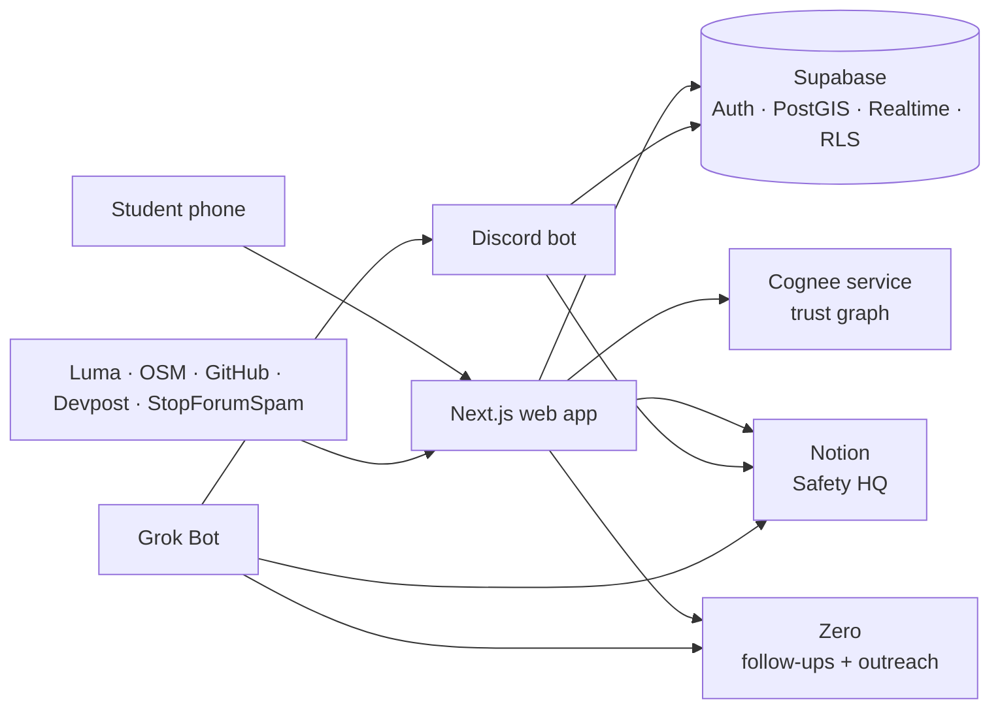

# 🐦 Flock

**Study together. Get home together.**

Flock is a verified community for **London university students** that makes late-night studying and events safe. Students join study sessions, find someone heading their way when it ends, and check in when they're home. If something goes wrong, their group and their society know straight away.

Built at the **Grok Bot Community Engineering London Hackathon** (22 Oct 2026) — **Wildcard track**. Built with **Grok Bot** and **Cursor**.

---

## The community

**London university students**, starting with members of **The Hack Collective**, a London community curated for university students.

## The problem

- Students study and attend events late, then **walk home alone**.
- Today the only option is asking "anyone going towards X?" in a group chat — a ~10 minute wait, often no reply, and no idea who's answering.
- Student group chats get **infiltrated by outsiders and scammers** (fake accommodation, ticket resale, phishing), and someone removed from one group simply joins the next.

## What Flock does

Flock keeps students safe at three moments:

| Moment | Feature |
|---|---|
| **Who gets into your groups** | Verified-only spaces: sign in with a university email. A blocklist is shared across communities so bad actors can't hop between groups. |
| **How you get home** | **Walk-buddy matching**: when a study session ends, Flock matches you with a verified student heading to a nearby station within 20 minutes, and explains why you can trust them. **Solo check-in timer**: if nobody's going your way, set an ETA; if you don't check in, your session group is alerted. |
| **What happens if something goes wrong** | A missed check-in or 🆘 creates an incident in the society's Notion Safety HQ. Grok Bot reviews it against the community's own safety rules and recommends an action. A human decides. |

## 10x over today

| | Today (group chat) | Flock |
|---|---|---|
| Time to find someone going your way | ~10 min, often never | < 30 seconds |
| Do you know who they are? | No | Verified student + trust reasons |
| Does anyone know you got home? | No | Check-in, with alerts if missed |
| Does a scammer removed from one group get blocked in the next? | No | Yes, shared blocklist |

## Partner integrations

| Partner | How Flock uses it |
|---|---|
| **Supabase** | Auth (university email magic link), Postgres + **PostGIS** for matching, **Realtime** for live matches, **RLS** on every table, shared blocklist |
| **Cognee** | Community trust graph: who studied together, who walked home safely together. Powers the "why you can trust them" reason on every match. |
| **Notion** | Society **Safety HQ**: Safety Rules page, Incidents database, Tonight dashboard |
| **Zero** | Growth: new members get a follow-up sequence; new societies enter an outreach pipeline |
| **Grok Bot** | Holds the spec and community context; set up Notion and Zero; posts session reminders in Discord; reviews incidents against Safety Rules |
| **Cursor** | Wrote the code — see [`BUILD_LOG.md`](BUILD_LOG.md) |

## Data sources

All public, all from the hackathon's Data starter kit:

- **Luma** calendar `.ics` (The Hack Collective) and event JSON — late events become study sessions; venue location and end time
- **Luma discover (London)** — how many London events end after 21:00
- **OpenStreetMap (Overpass)** — London stations as destinations (Flock never asks for a home address)
- **GitHub REST API** and **Devpost** — trust signals
- **StopForumSpam** — signup check
- **SMS spam dataset (Hugging Face)** — scam filter test set (stretch)

## Architecture



## Tech stack

Next.js (App Router) · TypeScript · Tailwind CSS · shadcn/ui · Leaflet · Supabase (Postgres, PostGIS, Auth, Realtime, RLS) · Cognee (Python, FastAPI) · discord.js · Notion API · Zero · Grok Bot · Cursor

## Run it locally

```bash
git clone <repo-url> && cd flock
cp .env.example web/.env.local   # fill in keys

# 1. Database: run supabase/schema.sql in the Supabase SQL editor, then seed
npx tsx scripts/seed-stations.ts
npx tsx scripts/import-luma.ts

# 2. Cognee service
cd ai-service && pip install -r requirements.txt && uvicorn main:app --port 8001

# 3. Web app
cd web && npm install && npm run dev

# 4. Discord bot
cd bot && npm install && node index.js
```

## Safety and privacy by design

- Destinations are **stations only** — never home addresses.
- Matches see **first names only**.
- Blocklist entries are **hashed**; no raw emails or handles are shared between communities.
- **Humans confirm** every report and block. Grok Bot only recommends.
- The 🆘 screen always says **call 999** first.
- No private member data in this repo. Seed data is synthetic.

## How it was built

Grok Bot held the spec, the safety rules and the community context, and set up Notion and Zero. Cursor wrote the code, one feature per prompt. Every step is logged with the tool that did it in [`BUILD_LOG.md`](BUILD_LOG.md).

## Licence

[MIT](LICENSE)
