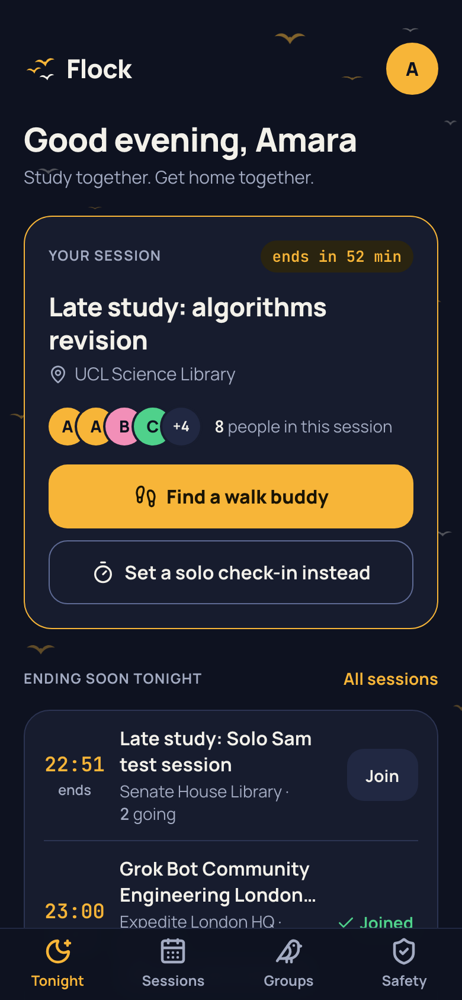
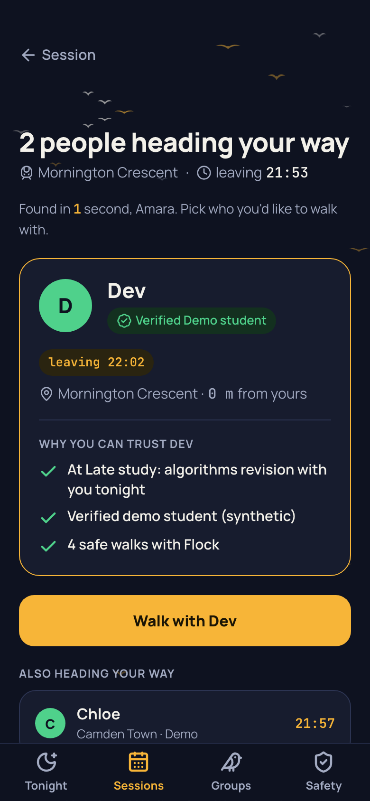
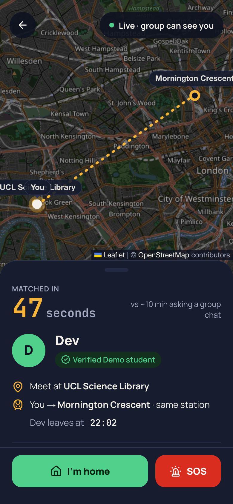
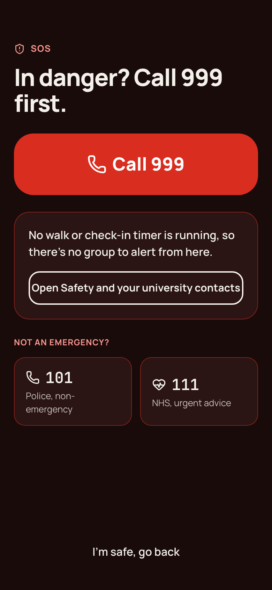
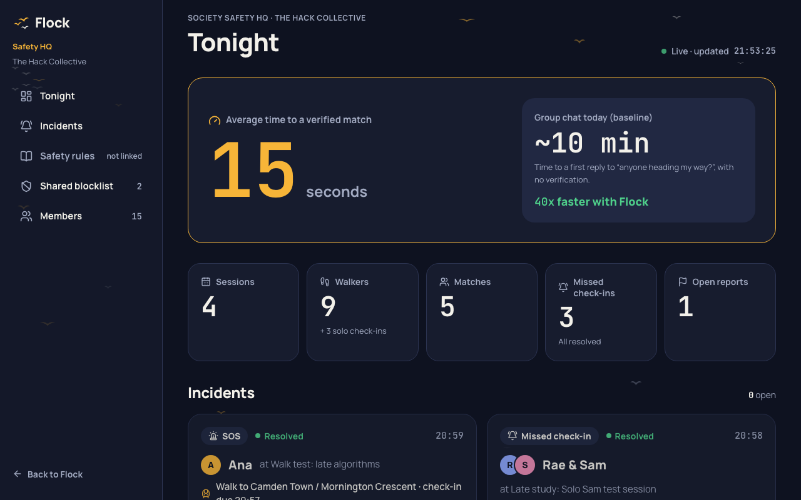
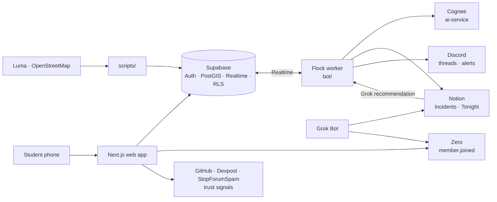

<div align="center">


# Flock

### Study together. Get home together.

A verified community for **London university students** that makes late-night studying and events safe.<br/>
Match with a verified student heading your way **in seconds, not minutes**. Check in when you're home. If something goes wrong, your group and your society know straight away.

[](LICENSE)


Built at the **Grok Bot Community Engineering London Hackathon** · 22 Oct 2026 · Expedite London HQ

</div>

---

<p align="center">
  
  
  
  
</p>
<p align="center"><sub>Tonight → pick who to walk with → walking home together → SOS, always one tap away</sub></p>

## The problem

**The community:** London university students, starting with members of **The Hack Collective**.

- Students study and go to events late, then **walk home alone**.
- Today's answer is "anyone heading towards Camden?" in a group chat: about a 10-minute wait, often no reply, and no idea who's answering.
- Student group chats get **infiltrated by outsiders and scammers**, and someone removed from one group simply joins the next.

## 10x over today

| | Group chat today | Flock |
|---|---|---|
| Time to find someone going your way | ~10 min, often never | **Seconds**, measured live on every match |
| Do you know who they are? | No | Verified university email + trust reasons |
| Does anyone know you got home? | No | Check-in, with alerts if it's missed |
| A scammer removed from one group… | …joins the next one | Blocked everywhere (shared, hashed blocklist) |

## How it works

Flock keeps students safe at three moments.

<table>
<tr>
<td width="33%" valign="top">

### 1. Who gets in
Sign in with a **university email** (checked server-side against each community's domains). Blocked accounts lose access to every community.

</td>
<td width="33%" valign="top">

### 2. How you get home
When a session ends, pick your **destination station**. Flock shows up to 3 verified students going within 1.5 km and leaving within 20 minutes, with **why you can trust them**. Tap "Walk with Dev" and the match appears on Dev's phone instantly. Nobody going your way? Start a **solo check-in timer**.

</td>
<td width="33%" valign="top">

### 3. If something goes wrong
A missed check-in or **SOS** creates an incident. It's posted to the session's Discord thread and the society's **Notion Safety HQ**. **Grok Bot** reviews it against the community's Safety Rules and recommends an action. **A human decides.**

</td>
</tr>
</table>

<p align="center">
  
</p>
<p align="center"><sub>Society Safety HQ: the 10x metric, tonight's numbers and every incident with Grok Bot's recommendation</sub></p>

## Partner integrations

| Partner | What it does in Flock | Where to look |
|---|---|---|
| **Supabase** | Email-code sign-in, university-domain check, **PostGIS** matching, **Realtime** live matches and live walk map, check-ins, shared blocklist, **RLS** on every table | [`supabase/schema.sql`](supabase/schema.sql), [`web/src/lib/supabase/`](web/src/lib/supabase), [`walk-request-screen.tsx`](web/src/app/sessions/%5Bid%5D/walk/walk-request-screen.tsx) |
| **Cognee** | Community trust graph: who studied together, who walked home safely together. Writes the "why you can trust them" line on each match | [`ai-service/main.py`](ai-service/main.py), [`bot/jobs/cognee.js`](bot/jobs/cognee.js) |
| **Notion** | Society Safety HQ: Safety Rules, Incidents database, Tonight dashboard | [`bot/jobs/incidents.js`](bot/jobs/incidents.js), [`bot/notion-schema.md`](bot/notion-schema.md), [`api/contacts`](web/src/app/api/contacts/route.ts) |
| **Zero** | Every new verified member triggers a follow-up sequence; societies go into an outreach pipeline | [`web/src/app/api/zero/route.ts`](web/src/app/api/zero/route.ts) |
| **Grok Bot** | Holds the spec and community context; sets up Notion and Zero; writes the bot copy; reviews every incident against the Safety Rules and recommends (never bans) | [`docs/GROK_BOT_CONTEXT.md`](docs/GROK_BOT_CONTEXT.md), [`bot/messages.js`](bot/messages.js), `grok-sync` in [`bot/jobs/incidents.js`](bot/jobs/incidents.js) |
| **Cursor** | Builds features from one prompt per step, guided by the repo's rules file | [`.cursor/rules/flock.mdc`](.cursor/rules/flock.mdc), [`docs/CURSOR_PROMPTS.md`](docs/CURSOR_PROMPTS.md) |
| Discord | Session threads, 15-minute "heading out?" reminders, missed check-in and SOS alerts, `/flock` | [`bot/jobs/sessions.js`](bot/jobs/sessions.js), [`bot/lib/discord.js`](bot/lib/discord.js) |

## Architecture



The phone talks only to the web app and Supabase. The **Flock worker** (`bot/`) listens to Supabase Realtime and does everything server-side: it asks **Cognee** for trust reasons, writes incidents to **Notion**, posts to **Discord**, and copies **Grok Bot's** recommendations back to Safety HQ. Every job is idempotent, so a restart never double-posts.

## Quick start

```bash
git clone https://github.com/wonseok522/flock.git && cd flock
# Create web/.env.local, bot/.env and ai-service/.env from .env.example

npm install && npm run seed:stations && npm run import:luma && npm run seed:demo   # data
cd web && npm install && npm run dev                                                # → localhost:3000
cd ai-service && uv venv --python 3.12 .venv \
  && uv pip install --python .venv/bin/python -r requirements.txt \
  && .venv/bin/uvicorn main:app --port 8001                                         # Cognee
cd bot && npm install && npm start                                                  # worker
```

Full setup (Supabase SMTP, Gemini key for Cognee, Notion, Discord, Zero), each with a "how to verify" step: **[`docs/SETUP.md`](docs/SETUP.md)**. The 3-minute demo script: **[`docs/DEMO.md`](docs/DEMO.md)**.

<details>
<summary><b>Project structure</b></summary>

```
flock/
├── web/          Next.js 16 app: screens, API routes (verify, zero, contacts, dashboard)
├── bot/          Flock worker: Supabase Realtime → Cognee, Notion, Discord
├── ai-service/   Cognee FastAPI service (/remember, /trust) on Google Gemini
├── supabase/     schema.sql (tables, RPCs, RLS, Realtime), seed.sql, test.sql
├── scripts/      OSM stations, Luma import, synthetic demo users
├── docs/         SETUP, DEMO, design system, build plan, Grok Bot + Cursor prompts
└── .cursor/      Cursor rules
```

</details>

## Tech stack

**Web** Next.js 16 · TypeScript · Tailwind CSS v4 · shadcn/ui · Leaflet + OpenStreetMap<br/>
**Data** Supabase (Postgres, PostGIS, Auth, Realtime, RLS)<br/>
**Services** Cognee on Python 3.12 + FastAPI + Google Gemini · discord.js · Notion API · Zero<br/>
**Agents** Grok Bot · Cursor

## Data sources

All public: **Luma** (The Hack Collective events, venue and end time) · **OpenStreetMap Overpass** (598 London stations) · **GitHub REST** and **Devpost** (trust signals) · **StopForumSpam** (sign-up check) · **SMS spam dataset** on Hugging Face (scam-filter test set).

## Safety and privacy by design

- **Stations only**, never home addresses. Live location is shared only during a walk and **stops automatically near the station**. It is never stored.
- Matches see **first names only**. No surnames, emails or phone numbers.
- Blocklist entries are **sha256 hashes**. No raw emails are shared between communities.
- **A human confirms** every report and every block. Grok Bot only recommends.
- The SOS screen always says **Call 999** first.
- No private member data in this repo. Demo users are synthetic (`@demo.flock.test`).

## How it was built

The specs the agents work from live in this repo: Grok Bot's context and jobs in [`docs/GROK_BOT_CONTEXT.md`](docs/GROK_BOT_CONTEXT.md), and Cursor's rules and step-by-step prompts in [`.cursor/rules/flock.mdc`](.cursor/rules/flock.mdc) and [`docs/CURSOR_PROMPTS.md`](docs/CURSOR_PROMPTS.md). Every commit message starts with the tool that did the work. See `git log --oneline`.

## Licence

[MIT](LICENSE)
